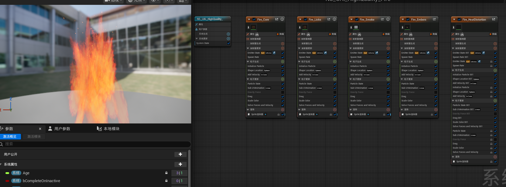
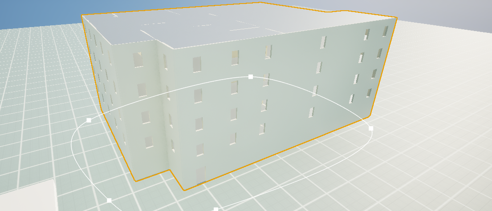
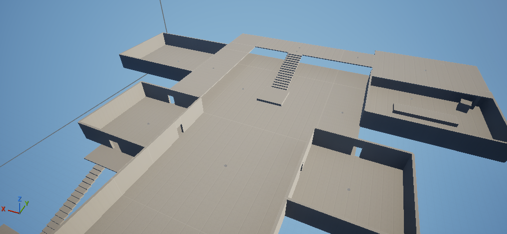
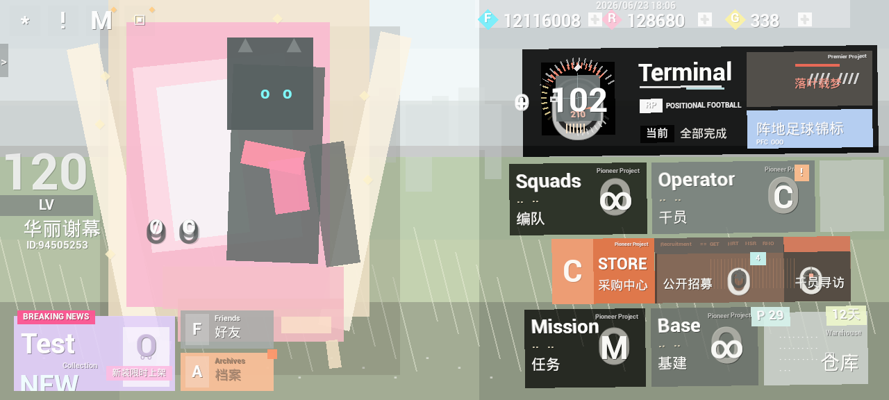
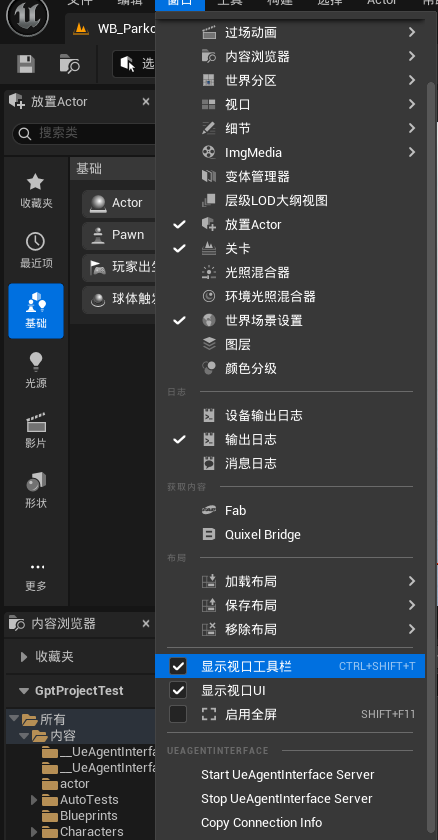

# UeAgentInterfacePak

本仓库统一分发 UAI 插件、Python SDK/CLI 的匹配 Git 引用、Codex skills 和 UE 知识内容。
当前基线是 **Windows + 带配套原生补丁的 UE 5.6.1**，需要源码构建插件及相关引擎模块。
从旧版升级请先阅读 [升级与旧版恢复](docs/UPGRADING.md)。

## 快速导航

| 要做的事 | 入口 | 边界 |
| --- | --- | --- |
| 了解 Pak 与安装方式 | 本 README、[升级说明](docs/UPGRADING.md) | 以所选 Pak 提交的子模块版本为准 |
| 修改 UE 插件或正式命令文档 | `UeAgentInterface/` submodule | 进入插件 owner 仓库单独开发、测试和提交 |
| 修改公开 Python SDK、薄 CLI 或发布工具 | `UeAgentInterfaceCMD/` submodule | 进入 CMD owner 仓库单独开发、测试和提交 |
| 维护 Pak 直接分发 skill | [`skills/README.md`](skills/README.md) | 区分 Pak-owned、submodule、external owner 与 installed |
| 查询 UE 本地知识 | `skills/ue-kb/SKILL.md`、`skills/ue-kb/kb-manifest.json` | 大体积 payload 通过知识入口消费，不参加父仓库普通搜索 |
| 审计重构前证据 | [`retired/strict_v2/README.md`](retired/strict_v2/README.md) | history-only；no-import、no-runtime、no-authority |

## 项目目标与当前证据边界

UAI 的根本目标是让 LLM 能操作 Unreal Engine，并完成符合用户意图的高质量 UE 内容。长期覆盖目标包括
UE 基础创作面以及 PCG、Paper2D 等适用官方插件能力；这是目标，不是当前完成声明。当前能力是否成立，
必须回到对应 Plugin/CMD commit、正式文档、真实 mechanics、持久化、独立读回和实际内容验收，不能由
README、command 数量、binding、示例图或旧测试外推。

当前还需遵守这些现实边界：

- 质量优先；质量同等充分时再降低 Token 与操作压力，两者不退化时再提高速度。
- 实机实时调试不属于当前可承诺能力。模型交互延迟、缺少连续视频理解和长序列帧识别衰减，使它无法
  承担要求实时反应的操作；截图、相机控制和短序列帧只能支持有界观察，不能冒充实时调试。
- 截图与结构读回仍可能遗漏或误判，视觉结果需要多证据校验。
- 默认不弹出或抢占 UE 窗口，不进行全屏调试；需要前台交互时应先取得用户授权。
- 当前验证基线是 Windows 与配套补丁的 UE 5.6.1；其他引擎版本和平台需要单独适配与验证，
  不限制调用模型品牌，也不把某个模型的一次成功视为所有组合均已验证。

## 效果一览

下面是项目在不同阶段、不同人工监督强度下得到的探索性展示。它们说明 UAI 工作流曾经介入过哪些
方向，但不构成当前版本的稳定能力承诺，也不保证能自动复现同等结果。

| 水面材质 | Niagara 火焰 |
| --- | --- |
|  |  |
| 多轮观察与调整后的水面材质探索。 | 多轮调整形态、烟、余烬和热扰动后的 Niagara 探索。 |
| PCG 建筑 | 白盒关卡 |
|  |  |
| PCG 建筑体块探索。 | 空间、路线和尺度验证的白盒尝试。 |
| UMG UI 复刻 |  |
|  |  |
| 对照参考图与结构读回，多轮修正布局、字号、分组和局部细节。 |  |

## 仓库内容与生命周期

| 路径 | 当前职责 | 安装或维护边界 |
| --- | --- | --- |
| `UeAgentInterface/` | UE Editor 插件的发布 gitlink | 普通使用需要插件；修改进入 nested owner，Pak 只更新已验证提交的 gitlink |
| `UeAgentInterfaceCMD/` | 公开 `uai` SDK、薄 CLI 与发布工具的发布 gitlink | Agent 使用 SDK 时需要可定位；修改进入 nested owner |
| `skills/ue-agent-interface/` | Pak-owned UAI 最小冷启动 skill，路由当前公开 SDK、项目 runner、HJSON、生命周期与验证 | 使用 UAI workflow 时安装；不镜像完整命令文档或内置旧 CLI，需要时显式同步 installed |
| `skills/ue-essential-knowledge/` | Pak-owned UE 核心知识导航分发候选 | 推荐；不承载任务级复盘 |
| `skills/ue-kb/` | Pak-owned UE 本地知识内容与索引分发候选 | 离线知识工作流使用；从 manifest/skill 进入 |
| `skills/kbcli-knowledge-base/` | kbCli runtime submodule 发布引用 | 由其外部仓库和 gitlink 管理，不做 installed-to-Pak 复制 |
| `understand-space`（外部） | AgentBase-owned 通用空间能力 | Pak 不保留同名副本；installed deployment 只跟随 AgentBase owner |
| `docs/images/` | 本 README 的展示与菜单图片 | 随包 |
| `retired/strict_v2/` | 重构前历史证据 | 不安装、不运行、不作为当前规范；逐消费者审计后才退出 |

版本组合由 Pak 提交的 gitlink 固定；更新和恢复步骤见 [升级说明](docs/UPGRADING.md)。

## 获取包内容

首次获取：

```powershell
git clone --recurse-submodules https://github.com/xianruiyang/UeAgentInterfacePak.git
```

如果只需要插件，可以直接使用插件 owner 仓库，并放到目标项目的 `Plugins/UeAgentInterface/`。使用
整个 Pak 时，子模块保持 Pak 固定的提交，不分别切到各仓库最新 main。已有 checkout 更新时遵循升级说明，
先保护本地改动，再更新子模块；本地未提交变化不会自动成为发布内容。

## 插件安装

1. 关闭使用目标引擎安装的 Editor，保存需要保留的修改。
2. 按 [引擎补丁说明](UeAgentInterface/EnginePatches/README.md) 为 UE 5.6.1 应用匹配补丁并重编对应模块。
   PropertyEditor、UMGEditor、AudioEditor、MetasoundEditor 的新增接口是当前插件的编译/链接依赖。
3. 在目标项目根目录创建 `Plugins`，将选定版本的 `UeAgentInterface/` 放到 `Plugins/UeAgentInterface/`。
4. 重新生成 C++ 工程文件并执行非 Live Coding 的 Editor target 构建。
5. 打开 `.uproject`，确认插件及其声明的依赖启用，再安装配套 SDK。

插件依赖以对应提交的 `UeAgentInterface.uplugin` 为准，不在 Pak README 复制一份容易失效的插件列表。
引擎版本或内置插件不匹配时，应先解决加载/编译问题，再使用 UAI 自动化。

普通项目 Editor target 构建不会自动重编 Installed Build 的引擎模块；只放入 Plugin 或更新公共头文件
不能完成安装。补丁源码随 Plugin 分发，引擎二进制需要在目标安装中构建，不由 Pak 携带。

## Skill 安装

完整工作流通常使用 `ue-agent-interface`；离线 UE 知识检索还会使用 `ue-kb` 和
`kbcli-knowledge-base`，`ue-essential-knowledge` 提供轻量主题导航。具体 owner 与同步边界见
[`skills/README.md`](skills/README.md)。

`C:/Users/<User>/.codex/skills/` 是机器 installed deployment，不是本仓库的另一份可随意反向覆盖真源。
Pak-owned skill 应从 Pak 向 installed 做显式同步；同步入口只接受已登记的 Pak publication owner。
`understand-space` 由 AgentBase 提供，不参加 Pak 同步，也不得从任意 Pak 同名路径
覆盖 installed。

`ue-agent-interface` 只教当前公开实现。`UeAgentInterfaceCMD/tools/sdk_environment.py install` 一起安装
公开 `ueagentinterfacecmd` 命令和 Python SDK，`uninstall` 一起移除。SDK 源码位于：

```text
<UaiCmdRoot>/cli/uai
```

单次查询使用 `ueagentinterfacecmd exec ...`，连续操作使用 SDK。在 GptProjectTest 开发工作区中还可使用
`scripts/ue/InvokeUaiCommand.py` 保存机器收据；该项目脚本不随 Pak 分发，其他项目使用 CLI 的 `--report`。
这些入口共用 CMD 的项目连接实现；入口缺失时使用上述正式安装入口。

## 启动服务与连接

安装并启用插件后，从 Unreal Editor 菜单打开：

`Window` → `UeAgentInterface` → `Start UeAgentInterface Server`



连续操作使用公开 `uai` SDK；本地项目连接由 CMD 共用实现持有：

```python
import uai

with uai.connect_project() as ue:
    result = ue.query.command_search(
        "inspect the current editor runtime",
    )
```

Python 只调用公开 SDK，不直接 HTTP，也不在客户端复制 UE 业务实现。每条 named method 或
`Client.execute()` 只应转发正式 manifest 中的一条真实 command；最终成功仍由该 command 的业务错误、
必要持久化和独立读回判断。

## 推荐工作流

1. 使用明确版本的插件、CMD 和 Pak skills，并确认它们的版本关系。
2. 启动 UE 项目，通过菜单开启 UAI Server；默认最小化或不抢焦点。
3. 安装配套 CMD，使用公开 `uai` SDK 或 `ueagentinterfacecmd`；项目 runner 仅在所属项目提供时使用。
4. 未知 command 先做名称发现，再批量取得所选名称的最小用法；节点、组件或 actor 候选优先使用可读名称，只有服务端返回同名 refine 时才使用最短选择器。
5. 临时 params、receipt、截图与运行输出写到任务专属 `tmp/<run-id>/`，不写入 Pak 或 skill 目录。
6. 对复杂资产优先使用结构化 authoring；应用后检查错误、warning、compile/settle、dirty resource、
   持久化、独立读回与必要截图。
7. 真实任务暴露基础能力缺口时，在正确 Plugin/CMD/knowledge owner 修复，再回到原内容复验。

## 知识库使用

`ue-kb` 是 portable knowledge content，`kbcli-knowledge-base` 提供查询 runtime。Hybrid 查询需要对应
vector service 与 embedding 环境；环境不完整时可降级到 keyword 或直接阅读 Markdown，但必须说明
降级状态，不能把 keyword-only 结果描述成 Hybrid。

最低限度的只读入口是：

- `skills/ue-kb/SKILL.md`
- `skills/ue-kb/kb-manifest.json`
- `skills/ue-kb/references/guides/standalone.md`
- `skills/ue-kb/references/maps/topic-map.md`
- `skills/ue-kb/references/maps/source-layout.md`

`ue-kb` 以及 `ue-agent-interface/knowledge/niagara-bplus` 内的大体积 `content/`、`chunks/`、
`references/`、`data/`、`indexes/` 和 `state/` 是有意分发 payload；Pak parent 的 `.ignore` 只让它们
退出普通发现，不改变 tracking 或知识职责。

## 普通发现合同

从 Pak parent 做普通 `rg`、`fd` 或 `srcq` 发现时，根 `.ignore` 默认跳过：

- 三个 nested repository；
- `retired/strict_v2/` 历史面；
- `ue-kb` 与 UAI skill 内嵌 Niagara knowledge 的大体积 packaged payload。

需要维护某个 owner 时，进入对应 nested repository 或使用明确路径；需要审计被排除对象时显式使用
`--no-ignore`。不要删除 `.ignore` 来做日常浏览，也不要把它当作内容不可达或可以删除的证据。

根 `.gitignore` 只排除 runtime、cache、临时、虚拟环境、package metadata 和 skill-local report 等
可重建本地输出。Knowledge indexes 是有 owner 的分发内容；是否保留不由“generated”或二进制形态
单独决定。

## 开发与发布维护

- Plugin、CMD 与 kbcli 是独立仓库；先在正确 owner 形成提交和证据，再由 Pak 更新 gitlink。
- `ue-agent-interface`、`ue-essential-knowledge` 与 `ue-kb` 是 Pak 直接分发候选；当前机器需要消费改动时
  直接同步 installed。
- `ue-agent-interface` 只维护从当前公开实现与已验证实践形成的最小 bootstrap 和按需 references；Plugin/CMD
  完整文档、通用 UE 教程、历史 schema、任务复盘和机器协议不进入活动 skill。
- 当前项目使用源码 SDK 与正式 runner。未来 packaged CLI 只有在出现独立真实消费者后，才作为单独发布
  能力从当前 CMD 构建、验证和登记；不把旧可执行文件或静态连接模板留作 skill fallback。
- `release dev-mirror` 只用于本地镜像或排查，不是正式发布。
- 正式发布按当前项目政策直接核对分支、HEAD、拟提交 diff 与 submodule gitlink，只纳入本次发布范围。
- GitHub push、tag 和 Release 需要用户明确授权；开发提交不会自动进入用户主线或远端。

## 参考

- [Epic：Plugins in Unreal Engine](https://dev.epicgames.com/documentation/unreal-engine/plugins-in-unreal-engine)
- [Epic：Working with Plugins](https://dev.epicgames.com/documentation/unreal-engine/working-with-plugins-in-unreal-engine)
- [Git：git-submodule](https://git-scm.com/docs/git-submodule)
